

  
   
  

 

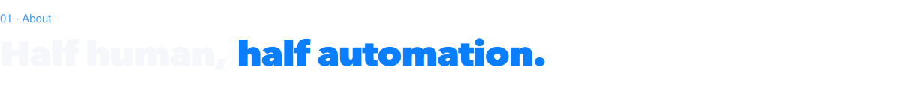

  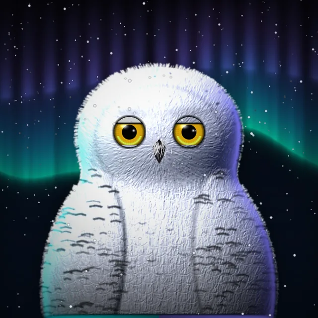
  

I build AI agents that take the busywork out of brand marketing. Give them a brief and they research the audience,
draft on-brand creative, schedule it across every channel, then watch the numbers and move budget to what works.
The owl is the mascot: quiet, sharp-eyed and on the night shift, just like the agents.

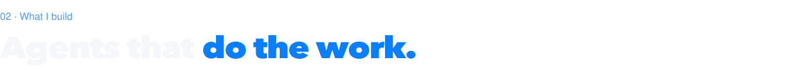


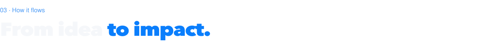


 



  
   
  

 


  

