  

  
  
  

<table>
<tr>
<td width="68%" valign="middle">
  
</td>
<td width="32%" align="center" valign="middle">
  
    
  🤖 half human, half automation
</td>
</tr>
</table>

> I like turning repetitive work into software that runs itself. Most days that means wiring
> large language models to real tools, building pipelines that grow products on autopilot,
> and deploying it all to the cloud so it never needs a babysitter.

  
   
  

<b>✨ How I work</b>

 

| | |
|---|---|
| 🧪 **Prototype fast** | A working demo beats a perfect plan. |
| 🔁 **Automate the second time** | Doing it twice? Write the script. |
| 📏 **Measure everything** | If it isn't tracked, it didn't happen. |
| 🚢 **Ship small, ship often** | Tiny releases, quick feedback, steady progress. |

  

